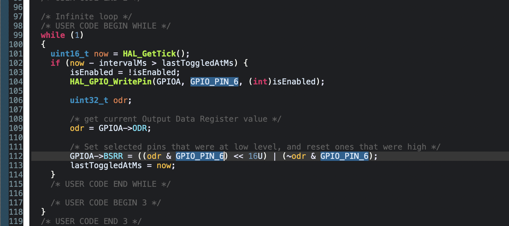

# stm32-playground

A bunch of learning projects using STM32F401CCUx Black Pill developemt board.

- [Pinout](https://mischianti.org/wp-content/uploads/2022/02/STM32-STM32F4-STM32F401-STM32F401CCU6-pinout-low-resolution.jpg);

## Lesson 46: blink without HAL

A small experiment on how we can toggle pin state without HAL. What I did is, I have just inspected the `HAL_GPIO_TogglePin` implementation and re-implemented it inside main superloop, toggling LED state using bit manipulation.