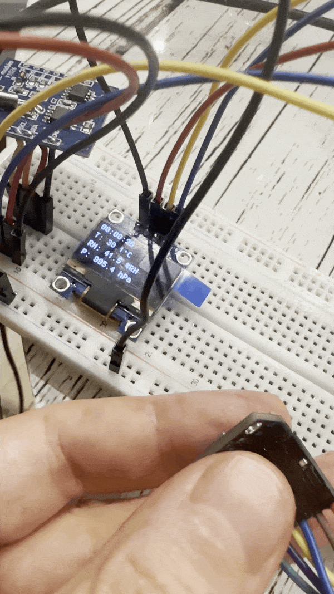
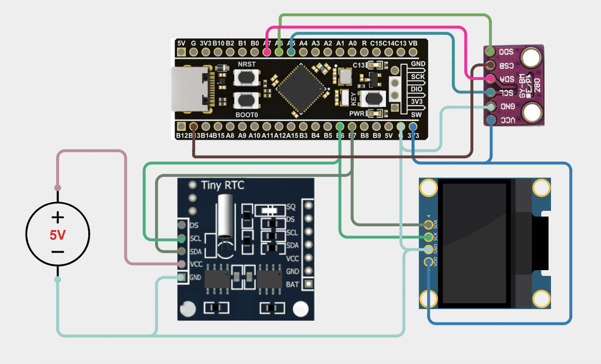

# stm32-playground

A bunch of learning projects using STM32F411 Black Pill developemt board.

- [Pinout](https://deepbluembedded.com/wp-content/uploads/2024/03/STM32F411CE-Black-Pill-Board-Pinout-Diagram.png);

## SPI communicaion

- Branched out off [I2C hometask branch](https://github.com/yuriymironov96/stm32-playground/tree/feat/lesson-41-42-i2c), keeping RTC and OLED in the scheme;
- Wired up BME280 sensor using SPI;
- Updated OLED display to show BME280 readings;

## Demo

## Fritzing

