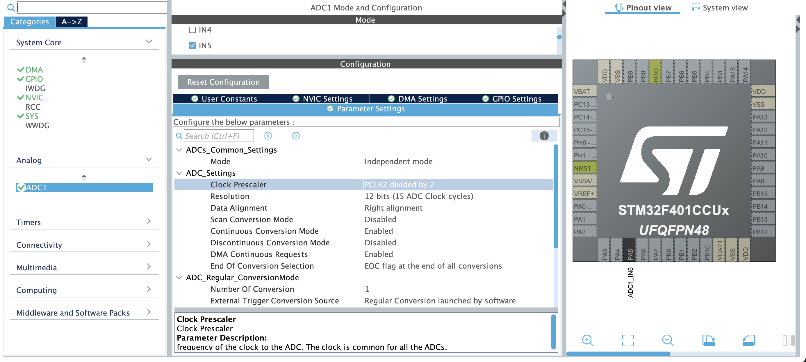
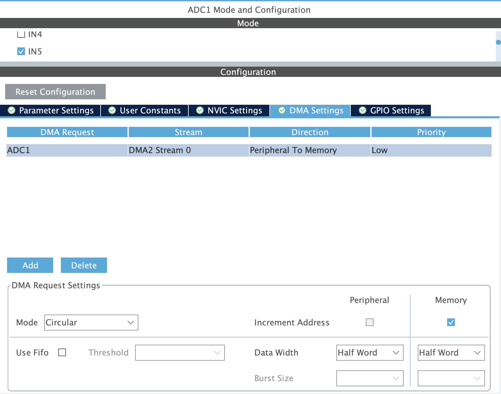
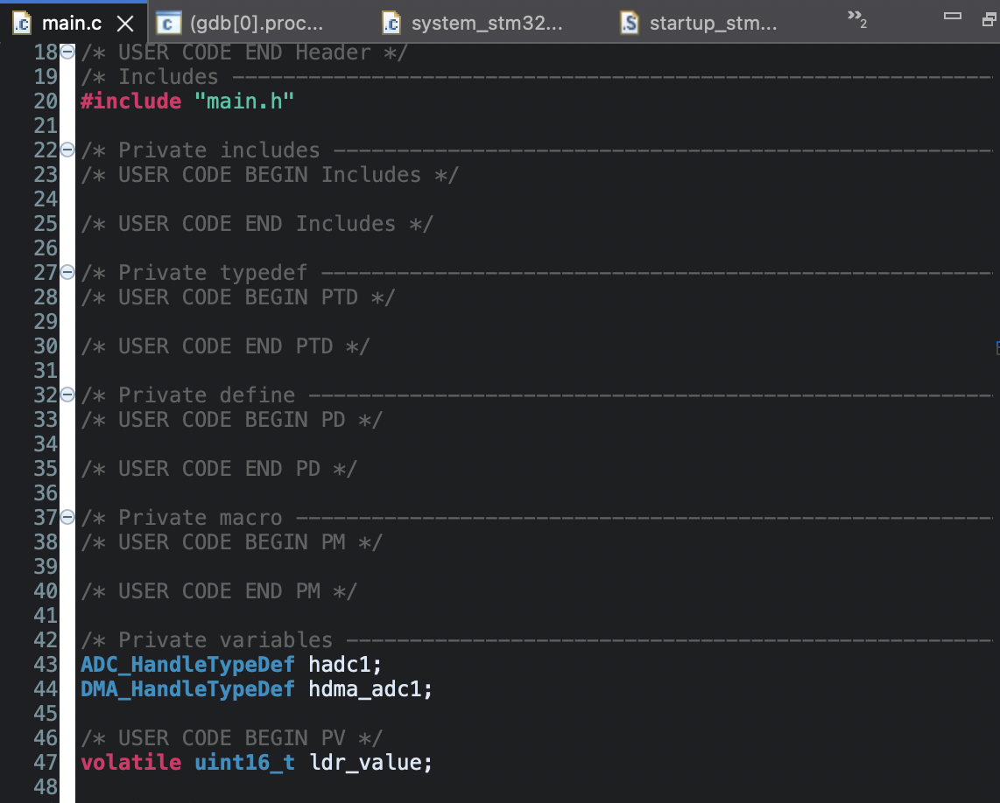
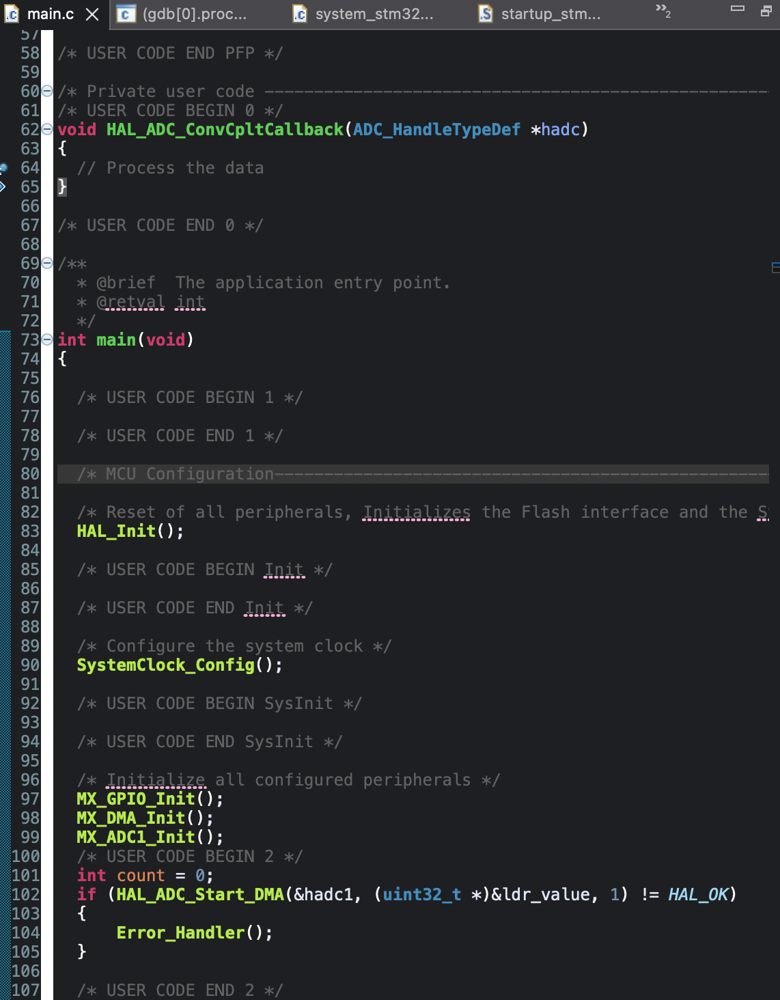
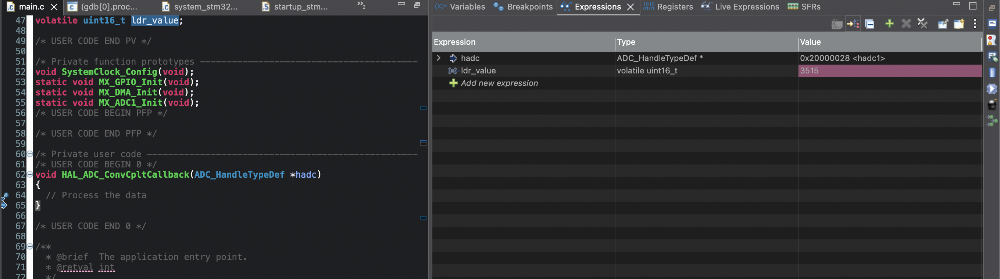
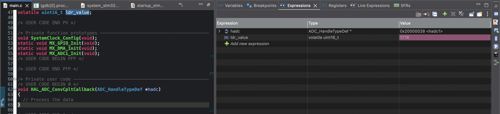

# stm32-playground

A bunch of learning projects using STM32F411 Black Pill developemt board.

- [Pinout](https://deepbluembedded.com/wp-content/uploads/2024/03/STM32F411CE-Black-Pill-Board-Pinout-Diagram.png);

## Lesson 45 - reading ADC using DMA

The goal is to read ADC values using DMA.

https://controllerstech.com/stm32-adc-multiple-channels-circular-dma/ - this article was used as a reference.

### STM32CubeMX config:

### Code

Declare `ldr_value` global variable to store value retrieved from ADC. It takes 16 bit because STM32 operates in 32-bit words, and DMA uses half-word data witdth.

Initialize DMA at line 102. Pass the pointer to `ldr_value` - DMA will write data there.

`HAL_ADC_ConvCpltCallback` will be fired when DMA writes new instance of data, and I use it to set breakpoints and read values.

### Demo

LDR was used as a source of analog signal. Covering it or letting it face the light change the values, which is reflected in debugger readings.

